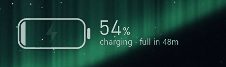
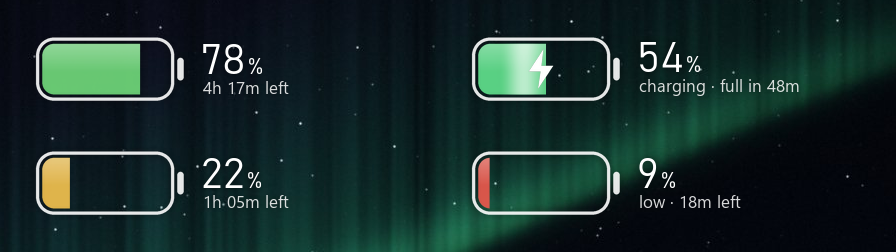
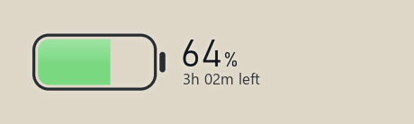

# Battery Widget

A pill battery for the Windows desktop with no background: just the battery and its text on your wallpaper.





## Features

- **Charging animation.** When you plug in, the fill sweeps up and flashes. While charging, a shine runs along it and the bolt pulses.
- **Colour by level.** Green, amber at 30% or lower, red at 15% or lower, and a slow pulse when critical.
- **Time left or time to full.** Read from Windows; time to full is estimated from how fast the battery charges.
- **Stays on the desktop.** Visible through Show Desktop, never on top of your windows, and clicks beside it go straight to the desktop.
- **Follows your wallpaper.** Light or dark text, chosen automatically.



## Install

Requires Windows 11 and Python 3.14.

```
py -3.14 -m venv .venv
.venv\Scripts\python.exe -m pip install -r requirements.txt
run.cmd
```

Drag to move, hold Ctrl and scroll to resize, and right-click for settings, including **Start with Windows**.

## License

MIT
